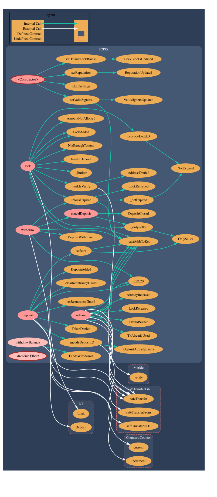

# p2pix-smart-contracts

**Repository for P2Pix EVM contracts to be imported by the project.**

## SM Dependency Tree

```rs
./contracts/
├── Constants.sol
├── DataTypes.sol
├── EventAndErrors.sol
├── lib
│   ├── auth
│   │   └── Owned.sol
│   ├── interfaces
│   │   └── IReputation.sol
│   ├── mock
│   │   └── mockToken.sol
│   ├── tokens
│   │   └── ERC20.sol
│   └── utils
│       ├── ECDSA.sol
│       ├── MerkleProofLib.sol
│       ├── Multicall.sol
│       ├── ReentrancyGuard.sol
│       └── SafeTransferLib.sol
├── p2pix.sol
└── Reputation.sol
```

## Callgraph



## Current Deployment addresses

### V1

| Testnet | Token Address                              | P2pix Address                              |
| ------- | ------------------------------------------ | ------------------------------------------ |
| Goerli  | 0x294003F602c321627152c6b7DED3EAb5bEa853Ee | 0x5f3EFA9A90532914545CEf527C530658af87e196 |
| Mumbai  | 0x294003F602c321627152c6b7DED3EAb5bEa853Ee | 0x5f3EFA9A90532914545CEf527C530658af87e196 |

<!-- All contracts deployed by 0x8dC06F985C131166570825F52447E8c88d64aE20 -->

<!-- https://goerli.etherscan.io/address/0x294003F602c321627152c6b7DED3EAb5bEa853Ee#code -->

<!-- https://goerli.etherscan.io/address/0x5f3EFA9A90532914545CEf527C530658af87e196#code -->

<!-- https://mumbai.polygonscan.com/address/0x294003F602c321627152c6b7DED3EAb5bEa853Ee#code -->

<!-- https://mumbai.polygonscan.com/address/0x5f3EFA9A90532914545CEf527C530658af87e196#code -->

### V2

| Testnet | Token Address                              | P2pix Address                              | Reputation Address                         | Multicall Address                          |
| ------- | ------------------------------------------ | ------------------------------------------ | ------------------------------------------ | ------------------------------------------ |
| Goerli  | 0x4A2886EAEc931e04297ed336Cc55c4eb7C75BA00 | 0x2414817FF64A114d91eCFA16a834d3fCf69103d4 | 0x2CFD9354Ec7614fEf036EFd6A730dA1d5fC2762A | 0x8FE009992d96A86c7f0Bccdaf1eC3471E302a8a6 |
| Mumbai  | 0xC86042E9F2977C62Da8c9dDF7F9c40fde4796A29 | 0x4A2886EAEc931e04297ed336Cc55c4eb7C75BA00 | 0x570445E3eF413bCDb5De79ed27B1c3840683e385 | 0x718B2C4DE4F9654E1349F610ff561249bfe1c418 |

<!-- All contracts deployed by 0x8dC06F985C131166570825F52447E8c88d64aE20 -->
<!-- https://goerli.etherscan.io/address/0x4A2886EAEc931e04297ed336Cc55c4eb7C75BA00#code -->
<!-- https://goerli.etherscan.io/address/0x2414817FF64A114d91eCFA16a834d3fCf69103d4#code -->
<!-- https://goerli.etherscan.io/address/0x2CFD9354Ec7614fEf036EFd6A730dA1d5fC2762A#code -->
<!-- https://goerli.etherscan.io/address/0x8FE009992d96A86c7f0Bccdaf1eC3471E302a8a6#code -->

<!-- https://mumbai.polygonscan.com/address/0xC86042E9F2977C62Da8c9dDF7F9c40fde4796A29#code -->
<!-- https://mumbai.polygonscan.com/address/0x4A2886EAEc931e04297ed336Cc55c4eb7C75BA00#code -->
<!-- https://mumbai.polygonscan.com/address/0x570445e3ef413bcdb5de79ed27b1c3840683e385#code -->
<!-- https://mumbai.polygonscan.com/address/0x718B2C4DE4F9654E1349F610ff561249bfe1c418#code -->

## Usage

### Pre Requisites

Before installing, create a `.env` file and set a BIP-39 compatible mnemonic and other env criteria as in `.env.example`.

### Install

```sh
$ yarn install
```

### Compile

```sh
$ yarn compile
```

**_NOTE:_** TypeChain artifacts generated at compile time.

### Test

```sh
$ yarn test
```

### Report Gas

```sh
$ REPORT_GAS=true yarn test
```

**_NOTE_:** Gas usage per unit test and average gas per method call.

### Clean

Delete the smart contract artifacts and cache:

```sh
$ yarn clean
```

## Importing artifacts

To import artifacts on the project use the following:

```ts
import P2PIXArtifact from "p2pix-smart-contracts/artifacts/contracts/p2pix.sol/P2PIX.json";
```

To grab deployment addresses you can just grab from deploys folder:

```ts
import localhostDeploys from "p2pix-smart-contracts/deploys/localhost.json";
```

## Deployment (Hardhat Ignition)

Deployments are orchestrated by
[Hardhat Ignition](https://hardhat.org/ignition). Each module declares its
contracts; Ignition handles ordering, idempotency, and per-network state
under `ignition/deployments/`.

### Modules

- `ignition/modules/MockToken.ts` — ERC20 mock used in dev / testnets.
- `ignition/modules/Reputation.ts` — Reputation + Multicall.
- `ignition/modules/P2PIX.ts` — wires Reputation + MockToken and deploys
  P2PIX via its constructor, returning the full set of addresses.
- `ignition/modules/P2PIXProd.ts` — same as `P2PIX.ts` but **does not**
  deploy MockToken. Token addresses are passed in via parameters
  (`tokens` + `allowed`), so existing on-chain tokens (e.g. BRZ, USDC)
  can be wired directly.

### Per-network parameters

Network-specific values (e.g. `defaultBlocks`, `validSigners`, MockToken
`supply`) live in `ignition/parameters/<network>.json`. Only
`localhost.json` is checked in; copy it to e.g. `goerli.json` and set the
network values before running the matching `deploy:*` script.

### Local environment

On the first terminal:

```sh
yarn hardhat node
```

On the second terminal:

```sh
yarn deploy:localhost
```

Addresses for every deployed contract are written to
`ignition/deployments/chain-31337/deployed_addresses.json` (this path is
gitignored — local-only state).

### Testnets

```sh
yarn deploy:goerli
yarn deploy:sepolia
yarn deploy:mumbai
```

Each command requires the matching `ignition/parameters/<network>.json`
and the relevant API keys in `.env`.

### Deploying without MockToken (production / real tokens)

Use the `P2PIXProd` module when the target network already has the ERC20
tokens you want P2PIX to support — no MockToken is deployed.

1. Copy `ignition/parameters/prod.example.json` to
   `ignition/parameters/<network>.json` and set:
   - `defaultBlocks`, `validSigners`
   - `tokens` — array of ERC20 addresses on the target network
   - `allowed` — array of booleans, same length as `tokens`
2. Run:

   ```sh
   yarn deploy:prod --network <network> --parameters ignition/parameters/<network>.json
   ```

   (e.g. `--network mainnet` or `--network polygon`, with the network
   defined in `hardhat.config.ts`).

The deployed Reputation/Multicall/P2PIX addresses are written to
`ignition/deployments/chain-<id>/deployed_addresses.json`.
